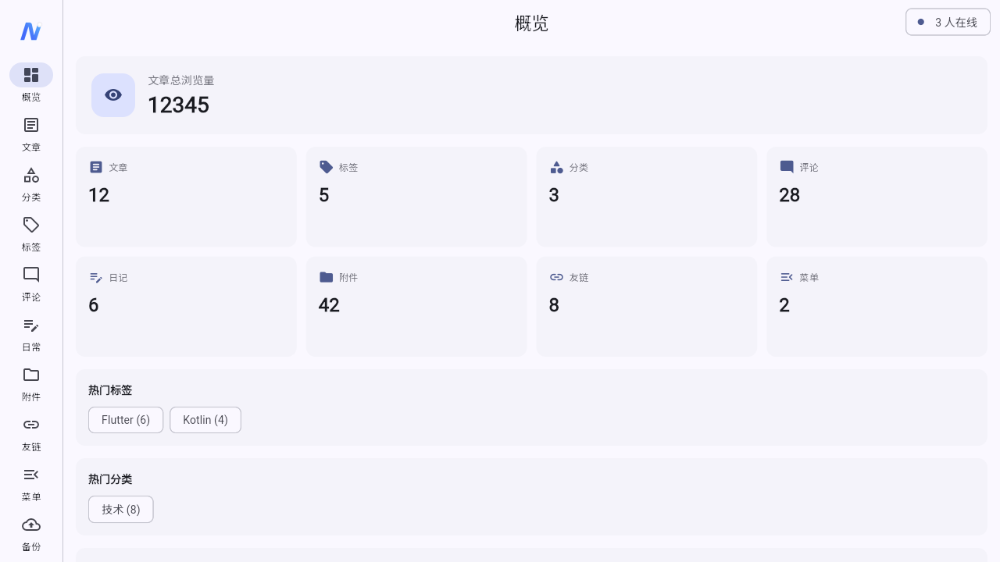
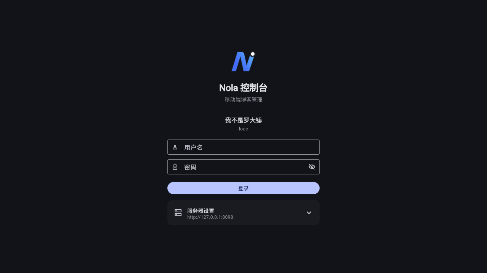
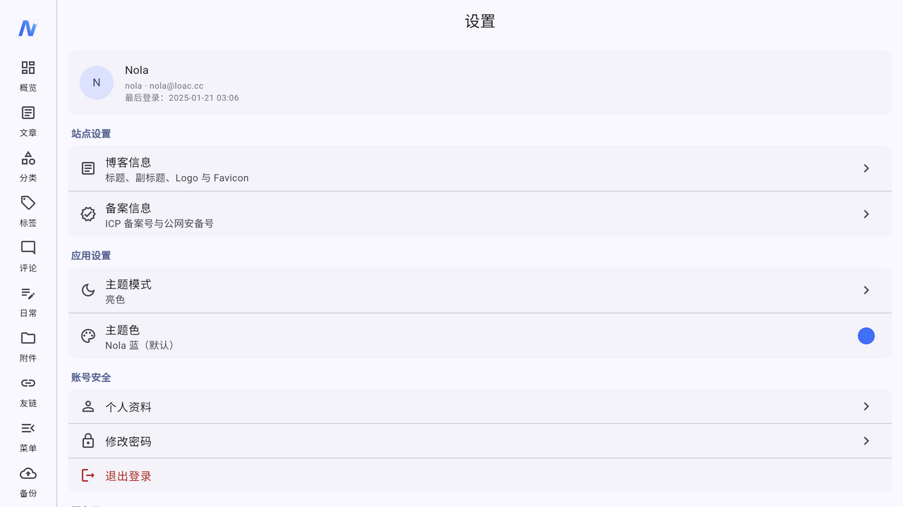

<div align="center"></div>

### Nola 博客的移动端管理后台（Flutter）。

当前仓库是 Nola 博客系统的 Flutter 管理端，通过 [Nola](https://github.com/LuodachuiXG/Nola) 提供的 `/admin` 管理接口，在手机上完成博客的日常管理。Web 控制台版本详见 [Nola-Console](https://github.com/LuodachuiXG/Nola-Console)。

[API 接口文档](https://apifox.com/apidoc/shared-82cab87c-63f3-4613-9264-69f4b68528ce)




### 一、✨ 功能

| 模块 | 说明 |
| --- | --- |
| 登录 | 账号密码登录、服务器地址配置、博客 / 管理员初始化引导 |
| 概览 | 博客统计、热门标签 / 分类、浏览量最高文章、SSE 实时在线人数 |
| 文章 | 状态 Tab（全部 / 已发布 / 草稿 / 回收站）、搜索与高级筛选、置顶 / 隐藏、回收与恢复、Markdown 编辑器（正文 + 草稿管理、草稿转正文） |
| 分类 / 标签 | 增删改查，分类封面上传与统一封面，标签配色 |
| 评论 | 筛选搜索、审核（通过 / 驳回）、编辑、删除，树形子评论管理 |
| 日常 | 日记增删改查与排序 |
| 附件 | 文件上传、分组管理、移动分组、本地 / 腾讯云 COS 存储配置 |
| 友链 | 增删改查、优先级、失联标记、排序 |
| 菜单 | 多菜单管理与菜单项树形编辑（父子层级、排序、打开方式） |
| 设置 | 博客信息（Logo / Favicon 上传）、备案信息、个人资料、修改密码、退出登录 |
| 应用设置 | 主题模式（跟随系统 / 亮色 / 暗色）、主题色切换，实时生效并持久化 |
| 备份 | 文章导入（md / txt）、导出（zip 分享）、备份恢复（预览 + 冲突策略） |
| 系统 | 操作记录、访问日志的查看与清理 |






### 二、🔨 运行

环境要求：

- Flutter 3.35+（开发时使用 3.47.7）
- 一台运行中的 Nola 后端（默认 `http://127.0.0.1:8098`）

1. 克隆本仓库到本机。
2. 运行 `flutter pub get` 完成依赖加载。
3. 运行 `flutter run`（Android / iOS / macOS / Web 均可）。
4. 在登录页的「服务器设置」中填写 Nola 后端地址，登录即可使用。

运行质量检查：

```bash
flutter analyze   # 静态分析
flutter test      # 单元测试（含请求体序列化回归测试）
```


### 三、📦 构建发布

```bash
# Android
flutter build apk --release

# iOS
flutter build ios --release

# macOS
flutter build macos --release

# Web
flutter build web --release
```

修改应用图标后，重新生成全平台启动图标：

```bash
dart run tool/pad_icon.dart        # 生成自适应图标前景图
dart run flutter_launcher_icons    # 生成全平台启动图标
```


### 四、🧱 项目结构

```
lib/
├── main.dart               # 入口：初始化本地存储并注入 Riverpod
├── app/                    # 应用根组件、主题、路由（go_router）
├── core/                   # 基础层：常量、存储、网络（dio + SSE）、模型、工具
├── shared/                 # 通用组件与分页状态基类（PagedNotifier）
└── features/               # 按功能模块划分（data / providers / ui 三层）
    ├── auth/               # 会话与登录
    ├── shell/              # 控制台 Shell（窄屏抽屉 / 宽屏侧栏自适应导航）
    ├── dashboard/          # 概览
    ├── posts/              # 文章与编辑器
    ├── taxonomy/           # 分类 / 标签
    ├── comments/           # 评论
    ├── diaries/            # 日常
    ├── links/              # 友链
    ├── menus/              # 菜单
    ├── files/              # 附件
    ├── settings/           # 设置
    ├── backup/             # 备份
    └── system/             # 系统日志
```

技术栈：[flutter_riverpod](https://pub.dev/packages/flutter_riverpod)（状态管理）、[go_router](https://pub.dev/packages/go_router)（路由）、[dio](https://pub.dev/packages/dio)（网络）、[shared_preferences](https://pub.dev/packages/shared_preferences)（持久化）、[file_picker](https://pub.dev/packages/file_picker)（文件选择）、[share_plus](https://pub.dev/packages/share_plus)（备份分享）。


### 五、🔗 相关仓库

- [Nola](https://github.com/LuodachuiXG/Nola)：后端服务（Kotlin / Ktor）
- [Nola-Console](https://github.com/LuodachuiXG/Nola-Console)：Web 管理控制台（Vue 3）
